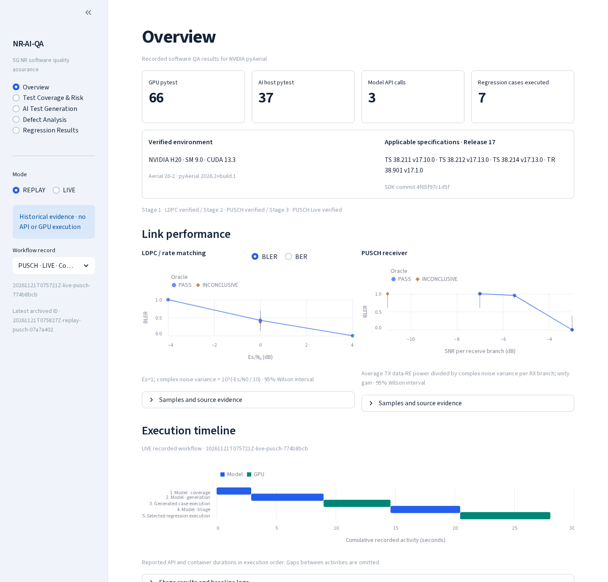
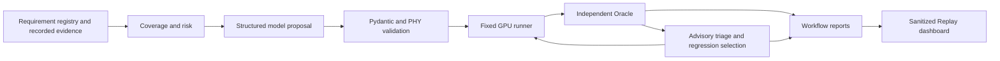

# NR-AI-QA: AI-Powered 5G NR Software Quality Assurance with NVIDIA pyAerial

## Overview

NR-AI-QA is a software test project for selected 5G NR PHY functions. It runs NVIDIA pyAerial and cuPHY on an H20, checks outcomes with independent oracles, and uses a structured LLM workflow to prioritize and propose bounded tests. The Streamlit dashboard opens recorded evidence without a GPU or an API key.

[All dashboard views](docs/stage4_results.md#replay-views) · [Architecture](docs/architecture.md) · [Recorded evidence](data/replay/portfolio.json)



## Motivation

GPU PHY failures can occur at a bit boundary, in a receiver configuration, or only under noisy conditions. A successful end-to-end CRC can hide intermediate errors. This project pairs targeted boundary tests, controlled fault injection and statistical link tests with traceable pass criteria.

## Key Features

- Real GPU LDPC, rate matching and PUSCH receiver tests on NVIDIA Aerial 26-2.
- Release 17 requirement IDs, clause mappings and a coverage matrix with explicit denominators.
- Risk-based case suggestions with local validation of references, PHY parameters, budgets and duplicates.
- Independent test verdicts, controlled fault detection, and policy-driven regression execution.
- A Replay dashboard with source paths, case seeds, measured confidence intervals and model provenance.

## System Architecture



The model proposes inputs, investigation hypotheses and registered regression cases. The existing test runner owns execution and verdicts. The GPU container mounts the pinned SDK read-only and runs with networking disabled.

## Technology Stack

| Area | Verified tooling |
| --- | --- |
| GPU PHY | NVIDIA H20 (SM 9.0), CUDA 13.3 runtime, Aerial 26-2, pyAerial 2026.2+build.1 |
| Test automation | Python, pytest, Pydantic, NumPy, Docker and NVIDIA Container Toolkit |
| Model integration | Alibaba Cloud Model Studio, `qwen3.8-flash`, strict JSON Schema |
| Portfolio | Streamlit 1.51.0, Altair 5.5.0, Pandas 2.3.3 |

## 3GPP Specifications

| Reference | Version | Project scope |
| --- | --- | --- |
| [TS 38.211](https://www.etsi.org/deliver/etsi_ts/138200_138299/138211/17.10.00_60/ts_138211v171000p.pdf) | 17.10.0 | Modulation, resource mapping and DMRS |
| [TS 38.212](https://www.etsi.org/deliver/etsi_ts/138200_138299/138212/17.13.00_60/ts_138212v171300p.pdf) | 17.13.0 | CRC, segmentation, BG selection, LDPC and rate matching |
| [TS 38.214](https://www.etsi.org/deliver/etsi_ts/138200_138299/138214/17.13.00_60/ts_138214v171300p.pdf) | 17.13.0 | MCS and transport block size |
| [TR 38.901](https://www.etsi.org/deliver/etsi_tr/138900_138999/138901/17.01.00_60/tr_138901v170100p.pdf) | 17.1.0 | TDL reference, pending verification |

See the [LDPC requirements](specs/ldpc_requirements.yaml), [LDPC traceability](specs/ldpc_traceability.yaml), [PUSCH requirements](specs/pusch_requirements.yaml) and [PUSCH traceability](specs/pusch_traceability.yaml).

## LDPC Testing

Checks cover selected BG1 and BG2 boundaries, segmentation, CRC, circular rate matching and redundancy versions 0–3. The bit-level rate-matching oracle detected a single injected bit flip that LDPC later corrected. The final TB CRC stayed zero. A separate bit flip before CRC checking was detected by the native checker. The AWGN report includes three 96-TB points and an eight-TB smoke case marked inconclusive.

## PUSCH Testing

The pinned NVIDIA example configuration drives the real Fused and Separable GPU receivers with matched IQ. Aerial's PDSCH transmitter emulates uplink transmission for the tested common coding and mapping subset. QA checks cover payload and CRC, representative MCS/PRB/DMRS changes, a Fused SISO case, and controlled receiver-side injection.

For the archived Fused AWGN profile, the payload BLER was 64/64 at −7 dB, 61/64 at −5.5 dB, and 0/64 at −3 dB. The zero-error point has a 95% Wilson upper bound of 5.66%. The dashboard shows seed, inputs, TB count, confidence interval and the per-branch data-RE SNR definition.

## AI-Powered QA Workflow

Requirement coverage and prior evidence feed a Python risk score. An LLM returns structured candidates. The runner checks existing case schemas, the approved PHY scope, requirement references, budgets and duplicate fingerprints before GPU execution. Triage works from observed facts and controlled hypotheses. Regression policy prioritizes registered Golden tests and known observations.

## Experimental Results

| Result | Recorded outcome |
| --- | --- |
| Original GPU pytest | **66 passed** across LDPC and PUSCH |
| Stage 3 AI host pytest | **37 passed** in the verified Stage 3 baseline |
| Live model workflow | **3** authenticated model calls, **5,220** tokens |
| Live generated PUSCH case | MCS **4**, **32 PRBs**, **2,536-bit** TB, seed **320601**, zero bit errors and CRC **0** |
| Scenario coverage | MCS × PRB changed from `NOT_COVERED` to `COVERED` after real execution |
| Live-selected GPU regressions | **7 executed**, 5 PASS and 2 EXPECTED_DETECTION |
| Controlled PUSCH findings | DMRS mismatch changed CRC/payload in **8/8** pairs. Noise bias changed active LLRs in **8/8** pairs. BLER impact of the bias remains inconclusive. |

The Live workflow ID is `20261121T075721Z-live-pusch-774b8bcb`. The archive also includes the earlier Live run that stopped before GPU execution after candidate validation failed, along with the successful replay of captured Live responses. See [recorded evidence](data/replay/portfolio.json).

## Reproducibility

The repository candidate includes a small, sanitized projection of selected real results. Its project-relative provenance paths identify the original local artifacts. Those raw artifacts, IQ arrays, model request identifiers, SDK and container are kept outside the publication set. Standalone Stage 1/2 evidence predates Workflow IDs. The dashboard identifies that origin explicitly.

The pinned SDK commit is `4f65f97c1d5f701ce911f7dda8f1b1f3f0c7693c`. The tested amd64 manifest is `sha256:fe79b31fe1703d6dbca78c72fa4463b0192804c97fb45f97d8ce740513affa24`. Seeds, SNR definitions, test status and confidence intervals are captured in the [Replay snapshot](data/replay/portfolio.json).

## Getting Started

### Quick Start · Replay

Use Python 3.10 or newer. Replay needs the published snapshot and dashboard dependencies.

```bash
python3 -m venv .venv
. .venv/bin/activate
python -m pip install -r requirements-dashboard.txt
PYTHONPATH=src python -m streamlit run src/nr_ai_qa/dashboard/app.py --server.address 127.0.0.1
```

Open the URL printed by Streamlit. Leave the mode set to **REPLAY**. Open **Test Coverage & Risk**, then **AI Test Generation**, **Defect Analysis** and **Regression Results**. The default record is the verified PUSCH Live run presented as historical evidence.

### Full GPU Setup

Use the [GPU reproduction guide](docs/gpu_reproduction.md) to obtain the official image, check out the pinned SDK, build pyAerial in the image, install the small Python dependency mount, and regenerate the historical inputs used by the Live planner. This setup was validated on H20 with driver 580.126.09. Other GPU and driver combinations need their own qualification.

With the environment ready, run `scripts/run_qa_container.sh -m pytest -q -p no:cacheprovider tests/ldpc tests/pusch`. Dashboard Live submits one scoped workflow through the existing CLI when a user confirms on the local server. Credentials belong in the server environment.

## Known Issues & Limitations

`BG-R067` reproduces a difference at A=3824 and R=0.67. The native encoder chose BG2 with its `0.67f` threshold, while the Python helper returned BG1 using `2/3`. The final TB impact is unverified. The reports retain `POTENTIAL_SDK_DEFECT`.

Results cover selected component and link-simulation profiles. The project does not provide 3GPP conformance certification, real-time gNB deployment or a general receiver benchmark. See [Known limitations](docs/known_limitations.md).

## References

- [NVIDIA Aerial CUDA-Accelerated RAN](https://github.com/NVIDIA/aerial-cuda-accelerated-ran)
- [NVIDIA pyAerial Getting Started](https://docs.nvidia.com/aerial/cuda-accelerated-ran/latest/pyaerial/getting_started.html)
- [NVIDIA PUSCH link simulation example](https://docs.nvidia.com/aerial/cuda-accelerated-ran/latest/content/notebooks/example_pusch_simulation.html)
- [Alibaba Cloud Model Studio structured outputs](https://help.aliyun.com/zh/model-studio/qwen-structured-output)
- [Licence review](docs/license_review.md) · [GitHub release audit](docs/github_release_audit.md)
