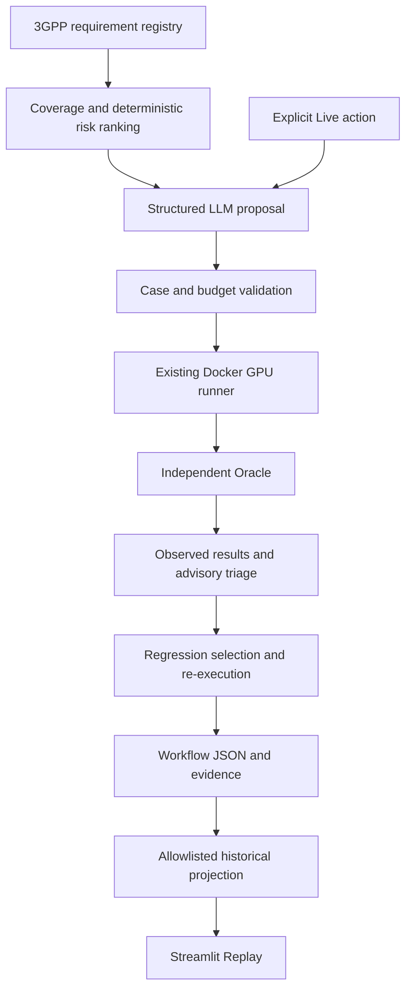

# Architecture

The dataset and dashboard provide a portfolio view of the verified receiver-testing workflow. Live operation uses the original CLI and its existing execution policies.

| Boundary | Responsibility |
| --- | --- |
| Requirement registry | Maps supported case IDs to clauses and recorded evidence, keeping unsupported and pending entries visible. |
| AI control layer | Requests bounded structured responses. Python calculates risk and validates IDs, the PHY envelope, duplicates and budgets. |
| GPU boundary | Runs fixed Aerial 26-2 through the existing Docker wrapper. SDK mounts are read-only and GPU test networking is disabled. |
| Oracle | Determines status using checks on CRC, bits, parameters or measured uncertainty. |
| Dashboard Replay | Loads the static JSON projection. It has no SDK, Docker or API dependency and never opens raw evidence paths. |
| Dashboard Live | Requires a local loopback server, usable host setup, a checked confirmation and a button press. It launches one fixed CLI invocation and holds a lock during execution. |

Coverage denominators remain those of the original registry. The dashboard combines the archived baseline matrix with separately recorded scenario changes. Each projected artifact identifies its original relative path and Workflow ID where applicable. A raw path is displayed as provenance, while the repository carries the selected JSON summary.

Link charts preserve smoke-test outcomes, samples and measured intervals. The execution timeline groups recorded model and container durations in order and omits unrecorded gaps. Defect views show the authoritative Oracle status next to a presentation label for injected faults or uncertainty. Hypotheses retain the original model assessment confidence and source.

For API support, the dashboard uses server environment variables. The browser supplies only a suite, registered requirement, registered risk topic and the start confirmation. Project code and SDK results use the original trusted paths.
